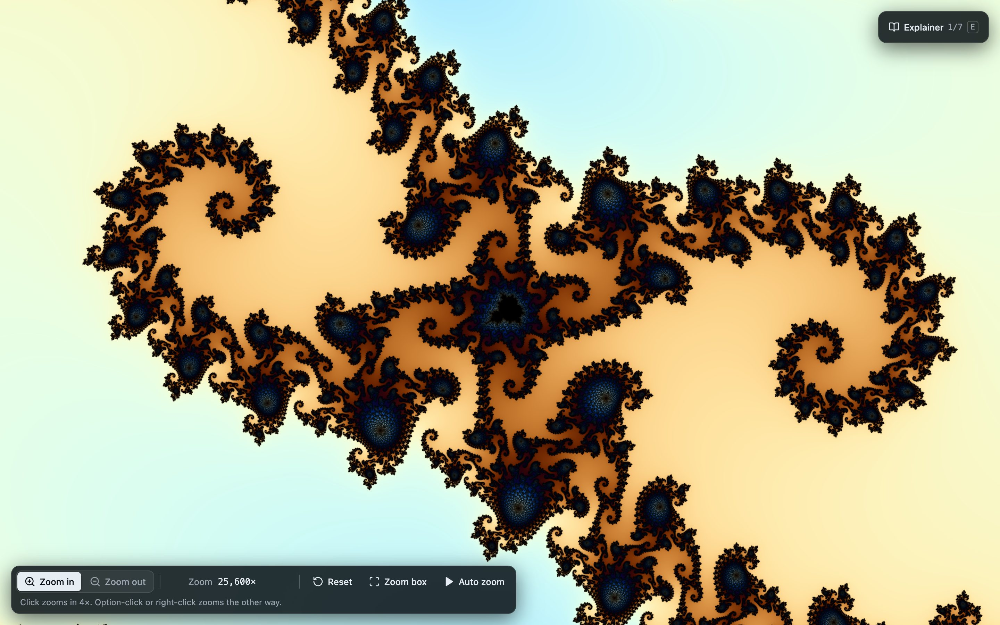
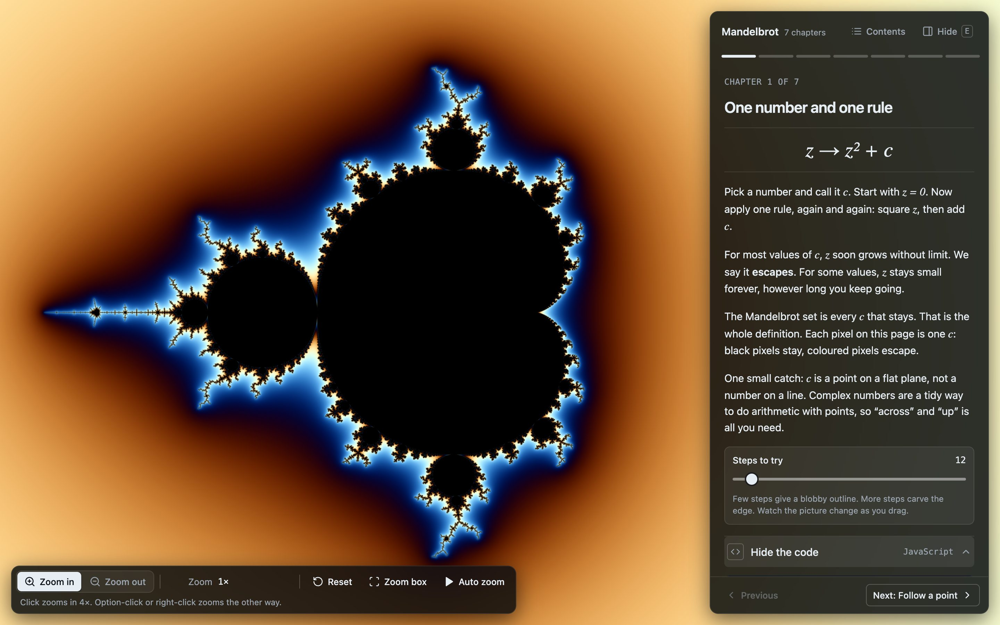
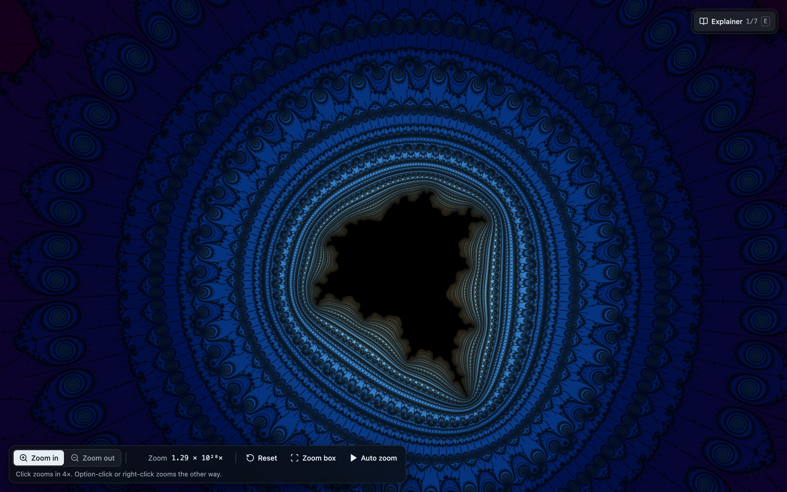

# Mandelbrot

An explorable Mandelbrot set for the web, with a deep zoom that stays sharp far past where
ordinary floating point gives up, and a short explainer beside it. Built with
[Exact](https://github.com/expo/exact) and WebGPU.



> Work in progress. The explainer has its first two chapters; chapters 3 to 7 are next.

## What it does

- **Click to zoom.** A click zooms 4× around the point under the pointer. Option-click or
  right-click zooms the other way. Drag pans and the wheel zooms. On a phone, a tap zooms.
- **Deep zoom.** The picture stays sharp past 10²⁸×.
- **An explainer beside the picture.** Seven short chapters. Each has a plain text that is always
  shown, and a code tier and a maths tier that open on request. On a phone it is a sheet.
- **The keyboard works too.** E opens and hides the explainer, + and − zoom, and the arrow keys pan.
- **Readable without WebGPU.** Where the browser cannot draw the picture, the page becomes a
  reading layout with a notice.





## How it works

The GPU draws in 32-bit floats, which run out of digits at about 10⁶× zoom. Three ideas take the
zoom much deeper.

- **Perturbation.** The CPU computes one point's orbit, the *reference*, with as many bits as the
  zoom needs. Every pixel on the GPU then iterates only its small difference from that orbit, which
  fits in 32 bits ([K. I. Martin](https://web.archive.org/web/20160408070057/http://superfractalthing.co.nf/sft_maths.pdf)).
- **Rebasing.** When a pixel's orbit comes closer to zero than its difference, the pixel restarts
  from the start of the reference. So one reference serves the whole view, with no glitches
  (Zhuoran, 2021; [mathr.co.uk](https://mathr.co.uk/blog/2022-02-21_deep_zoom_theory_and_practice_again.html)).
- **Bilinear approximation (BLA).** Where the difference stays small, one table entry skips
  many iterations at once. Near 10²⁹× it skips more than 99% of them (mathr.co.uk, as above).

The picture is drawn in two passes. While the view moves, a low-resolution preview is drawn in bands
of rows, so no frame waits for the GPU. When the view rests, it sharpens to 16 samples a pixel.
Pixels inside the set stop early, and edges are coloured by their distance to the set, so thin
filaments stay visible.

| Part | Where |
| --- | --- |
| The reference orbit, in high precision | `gpu/src/deep.rs` |
| The BLA table | `gpu/src/bla.rs` |
| The pixel loop: perturbation, rebasing, BLA, colour | `gpu/shaders/mandel.wgsl` |
| Previews, sharp passes and the view | `gpu/src/lib.rs`, `gpu/src/draw.rs` |
| The page: controls and explainer | `app.contract` |
| The chapters' text, code and maths | `content.ts` |

## Run it

You need [Bun](https://bun.sh), [Rust](https://rustup.rs) and a browser with WebGPU, such as Chrome.

Clone Exact next to this repo, and fetch what it needs once:

```sh
git clone https://github.com/expo/exact.git
git clone https://github.com/kadikraman/mandelbrot.git
cd exact && bun scripts/exact.mjs setup && cd ..
```

Then start the page:

```sh
cd mandelbrot
bun exact.mjs web
```

Open the URL it prints. This README was last checked against Exact at `523457e1a`.

## Test it

```sh
bun exact.mjs test web     # the page's Contract tests, in a browser
cd gpu && cargo test       # the renderer's Rust tests
```

Run the Contract tests first: they generate the Rust workspace that `cargo test` uses.

## Build it

```sh
bun exact.mjs web-build --out dist   # the static site, for any static host
bun exact.mjs serve dist             # serves it locally, as a host would
```

## Layout

```
app.contract        the page: the canvas, the explore controls and the explainer
app.test.contract   the page's tests
content.ts          the chapters' text, code and maths
app.ts              serves the chapters to the page
app.json            the app's name, id and host
gpu/                the renderer, a Rust crate on Exact's GPU surface
  src/              the view, the reference orbit, BLA and the GPU passes
  shaders/          WGSL for the set and the composite
docs/               the pictures in this README
```

## Credits

- Deep zoom methods: K. I. Martin (perturbation), Zhuoran (rebasing), and Claude Heiland-Allen's
  write-ups at [mathr.co.uk](https://mathr.co.uk/) (rebasing and BLA).
- The deep point is from Robert Munafo's [Mandelbrot Set Glossary](https://mrob.com/pub/muency/deepest.html).
- Smooth colouring and cosine palettes: [Inigo Quilez](https://iquilezles.org/).
- High-precision arithmetic: [astro-float](https://github.com/stencillogic/astro-float).
- Icons: [Lucide](https://lucide.dev), under the ISC licence (see [NOTICE](NOTICE)).

## Licence

MIT. See [LICENSE](LICENSE). Lucide's icon shapes are under their own licence, in [NOTICE](NOTICE).
